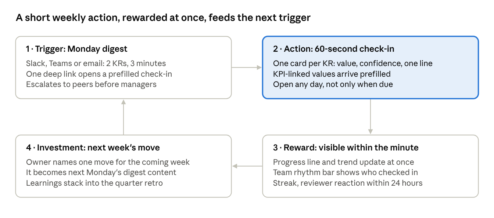

# OKRGoal UX and Habit Review

Source: `OKRGoal_UX_and_Habit_Review.docx` by Dirk Schmellenkamp, dated 13 October 2026, a walkthrough of the public demo as "Demo Operator". Converted to Markdown on 30 October 2026. The text is the reviewer's, unchanged. The audit of each finding against the code is in a separate section at the end.

Oct 13, 2026 · Dirk Schmellenkamp

## Summary

The demo is built around the OKR method, not around the person who has to show up every week. Three things block a weekly habit today: numbers a user cannot trust, a backlog of 241 overdue items that greets the user on day one, and a check-in that refuses input unless the goal is "due". Fix trust first, then the weekly loop, then navigation.

Top changes, ranked by expected effect on weekly active use:

- Fix key result progress math. Progress is calculated as current / target instead of baseline-to-target, so a KR that has not moved shows 89%.

- Replace the overdue wall in Review. Collapse stale acknowledgements, expire them after a set window, and offer "clear everything older than 14 days".

- Allow a check-in at any time. Make a 60-second check-in the default home screen for KR owners.

- Give each role its own home ("My week") instead of showing everyone the company Work Map.

- Put real content in notifications. The Inbox shows "Something happened here." 50 times with no goal name.

- Add positive feedback: a personal and team check-in streak, and a visible reaction when a reviewer acknowledges.

- Cut the sidebar from 15 unlabeled icons to about 5 labeled areas. Move method settings out of the daily path.

- Remove internal development notes from product copy.

Brand note: the browser tab reads "OpenOKR demo", not OKRGoal. Decide which name prospects should see.

## Trust breakers

A user who spots one wrong number stops trusting every number, and stops updating. These were all visible in the demo on 13 Oct 2026.

| Issue | Where | Evidence | Fix |
|---|---|---|---|
| KR progress uses current / target, ignores baseline | Home, OKRs | "Raise self-serve deflection from 31% to 35%": current 31, progress 89%. Expansion seats 158 of 200 (baseline 158): 72%. NRR 101 of 104 (baseline 101): 92% | Progress = (current minus baseline) / (target minus baseline) for every KR, KPI-linked or not |
| Wrong target shown | Home "Next step" | Uptime KR "at or above 99.9%" shows "99.95 of 100 %". GRR "at or above 92%" shows "93 of 100 %" | Show the KR's own target; for maintain KRs show "99.95 / floor 99.9" |
| Decrease KRs read backwards | Home | "101 of 95 $", "38 of 35 minutes", "6.82 of 6 %" | Use direction-aware wording: "101 now, target 95" |
| Health contradicts progress | Home | A KR at 100% shows Pending. Objective with 0% and 89% KRs shows 44% | Derive a default health from pace; Pending only until first check-in, labelled "No check-in yet" |
| Gate contradicts data | Goal detail | "No parent ... publish gate 3 is red" while the side panel shows Supports: "Grow profitably from the customers we keep" | Recompute gate from the same alignment data the panel uses |
| Cycle counter wrong | Cycle | "1 of 7 done" while phase 1 is 3 of 10 and phase 4 is checked | Count only completed phases in order, or show "Phase 4 done, Phase 1 open" |
| Two lists disagree | Review vs Check-in | Review: "Post your check-in on Grow profitably... Monday". Check-in page: "Nothing of yours is due" | One source for "what I owe" |
| Empty notifications | Inbox | 50 unread items, all "Something happened here." with no goal name | Render subject, actor, change, link |
| Empty timestamps | Review, "Why you got nudged" | "Sent ." on every row | Print the date or hide the field |
| Copilot did not open | Top bar "Ask" | Click produced no visible panel | Verify; if it is gated in the demo, say so |

## Habit loop

The current loop runs on pressure alone. Triggers are escalations (champion at due, reviewer after 3 days, coordinator at 7, sponsor at 14). The action is hard to reach. Nothing rewards the user for doing it.

What the demo does today:

- **Trigger:** overdue counters and escalation nudges. The first screen in Review is "241 overdue", some items 267 days old. A new user cannot clear that, so the rational response is to ignore it.

- **Action:** the check-in page refuses input until the goal is due ("This goal is not due. Its next check-in is 2026-10-19"). A user who has news on Wednesday has nowhere to put it. The OKRs list renders every objective as an open edit form, which reads as work, not as a status.

- **Reward:** none visible. Acknowledging is a chore for the reviewer and silent for the owner. The private confidence vote with "Reveal together" is the one social mechanic, and it is buried inside the check-in page.

- **Investment:** nothing the user puts in this week makes next week easier.

- **Tone:** copy lectures. "Snoozing stops the messages. It does not clear what you owe, and the list above will not move." Users read that as blame.

The redesigned loop (diagram below) keeps the method's rigour but moves it behind a short, rewarding weekly action. Escalation stays, but starts later and goes to peers before it goes up the hierarchy.

Diagram text, for readers without the image:

| Step | Content |
|---|---|
| 1. Trigger: Monday digest | Slack, Teams or email: 2 KRs, 3 minutes. One deep link opens a prefilled check-in. Escalates to peers before managers |
| 2. Action: 60-second check-in | One card per KR: value, confidence, one line. KPI-linked values arrive prefilled. Open any day, not only when due |
| 3. Reward: visible within the minute | Progress line and trend update at once. Team rhythm bar shows who checked in. Streak, reviewer reaction within 24 hours |
| 4. Investment: next week's move | Owner names one move for the coming week. It becomes next Monday's digest content. Learnings stack into the quarter retro |

The check-in card is the product's centre. Everything else (cycle phases, gates, quality checks) feeds it or reads from it.

## Role plans

Priority order: KR owners first, because without their check-ins reviewers and champions have nothing to act on. Each role gets one home screen and one weekly action.

| Priority | Role | Weekly job | What blocks it today | Change | Habit signal |
|---|---|---|---|---|---|
| 1 | KR owner / team member | Update 1 to 4 KRs, flag a blocker | Check-in locked until due; goals list is an edit form; home is the company tree | "My week" home: my KRs as check-in cards, last value, trend, one free-text line. Check in from Slack/Teams/email without opening the app | Share of owners who check in on time, 4 weeks in a row |
| 2 | Reviewer / manager | Read the team's check-ins, react, unblock | 241 overdue acknowledgements, each a separate button, no content preview | Team digest: one screen with every check-in since last week, inline "Acknowledge all" plus per-item reaction or comment. Old items auto-close after 14 days | Median hours from check-in to acknowledgement |
| 3 | OKR champion / admin | Run the cycle, watch rhythm and quality | Method lives in 40+ admin thresholds and gate texts; Phase banner shows on every page for every user | Champion cockpit: rhythm by team, quality warnings, gates, one place. Hide phase banner from non-champions | Teams with a published set by day 14; rhythm above 75% |

Two more roles worth naming: the sponsor (executive) needs a 2-minute monthly read, and the facilitator needs session mode. Both exist in the product today but sit outside a role home.

## Navigation and information architecture

The sidebar holds 16 icon-only links. Personal account settings (security, API tokens, connections, AI) sit at the same level as daily work. Several pairs do the same job: Inbox and Review both list what needs attention; Initiatives and Board both hold work items, and the demo Board is empty. Proposed: five labeled areas plus the avatar menu.

| Today | Proposed home | Note |
|---|---|---|
| Home (Work Map) | **My week** | Role-based. Company tree moves to Goals |
| Inbox + Review | **Updates** (bell, one list) | Tabs: To do, Mentions, Activity. One counter |
| Goals, KPIs | **Goals** | Tabs: OKRs, KPIs, Map. KPI links shown on the KR, not only in a separate grid |
| Initiatives + Board | **Work** | One object, two views (list, board). Empty state shows a filled example |
| Spaces | **Teams** | Team page = its OKRs, check-in rhythm, members |
| Cycle, Sessions, Scorecard | **Cycle** (champions and facilitators only) | Hidden for team members; the phase banner goes with it |
| Search | Top bar (already there, ⌘K) | Drop the duplicate sidebar icon |
| Channels, Security, API tokens, Connections, AI | Avatar menu, "Settings" | Personal settings, used once |
| Admin | Avatar menu, "Workspace admin" | Admins only |

Other layout fixes:

- Labels next to icons, at least on hover, and always on first use.

- Objective titles are cut to a few characters on Home ("S…", "K…") when the side panel opens. Wrap titles to two lines and let the panel overlay the table.

- The OKRs list shows 7 filter groups before the first goal. Default to "Mine", collapse the rest behind one Filter button, keep the AI filter box.

- Goal detail mixes weekly content (KRs, check-ins) with one-time actions (move cycle, link KPI, delete). Split into a main view and a "Manage" tab.

## Copy, density and visuals

The copy is precise but written for the people who built the method, and it explains system internals to end users. Rule of thumb: tell the user what to do next, in under 12 words, and move the reasoning to a help link.

| Seen in the demo | Problem | Suggested |
|---|---|---|
| "There is no lower bound since P9-T02's review: whatmatters' own ... is three words" (Admin, Rhythm) | Internal ticket ID and change history in product copy | "Warn above 18 words." |
| "The floor was five until 2026-08-17: it held for a mid-sized company and blocked a team of eight..." | Changelog inside a setting | Move to release notes |
| "Private until the reveal ... because the numbers are not sent to the browser at all" | Implementation detail | "Votes stay hidden until everyone reveals together." |
| "Both roles are access-bearing, so moving one rebinds access with it" | Jargon | "Changing the owner also changes who can edit." |
| "Computed on the server, overdue first." (Review header) | Says how, not why | "Your open items, oldest first." |
| Value field "101 $ ... out of 10" on goal detail | Confidence scale sits next to the money value with no label | Label "Confidence (0 to 10)" on its own row |
| "Pending" as a health state | Reads as "waiting for approval" | "No check-in yet" |
| Sidebar "Spaces", page title "Teams"; "Champion" vs "Owner" | Two names per concept | One term each, set in Admin, Terminology |
| Dates as "2026-10-19" and "13 Oct, 01:53" | Mixed formats | Follow the user's locale; relative for the next 7 days ("Mon") |

Demo data also hurts the first impression. Every Inbox item has the same timestamp (2026-10-12 19:01), Review has 241 items up to 267 days overdue, and the Board is empty. A prospect sees a neglected workspace. Seed the demo with a healthy team: most check-ins on time, a few at risk, a filled board, and real notification text.

## Metrics

One north-star: the share of KR owners who check in on time in a given week. The product already measures this as "rhythm" (75% threshold in Admin), so it can be exposed without new tracking. Targets below are starting proposals, not benchmarks; set them after 4 weeks of baseline data.

| Metric | Definition | Role | Proposed starting target |
|---|---|---|---|
| On-time check-in rate (north-star) | Owners with a check-in within tolerance of due date / owners with a KR due | Owner | 75%, the product's own threshold |
| 4-week streak share | Owners with 4 consecutive on-time weeks / all owners | Owner | Set after baseline |
| Time to check in | Median seconds from opening the card to submit | Owner | Under 90 seconds |
| Check-ins outside the app | Share submitted from Slack, Teams or email | Owner | Track; no target |
| Acknowledgement latency | Median hours from check-in to reviewer response | Reviewer | Under 24 hours |
| Open review items per reviewer | Unacknowledged items older than 7 days | Reviewer | Close to 0 after auto-close ships |
| Digest click-through | Opens of the Monday deep link / digests sent | All | Track; no target |
| New-workspace activation | Workspaces with first published set and first round of check-ins within 14 days | Champion | Set after baseline |
| WAU / MAU | Weekly active users / monthly active users | All | Weekly product: aim high, track trend |

## Blind spots, risks and assumptions

This review is one walkthrough of one demo account, so treat every recommendation as a hypothesis to test, not a finding from users.

- **Evidence base is thin.** I saw the product as "Demo Operator" (manager and admin). No real usage data, no user interviews, no mobile test, and the copilot did not open. Before building, run 5 to 8 short interviews per role and pull the current on-time check-in rate.

- **Demo seed vs product logic.** The 241 overdue items and identical timestamps may be seed artifacts. The progress formula and the locked check-in are almost certainly product logic. Fix the demo regardless: it is a sales asset.

- **The method is the moat.** OKRGoal's rigour (gates, quality checks, escalation ladder) is what separates it from generic tools and what OKRI certifies. Simplifying the owner's view must not dilute it. Keep it intact for champions; hide it from owners.

- **Buyer is not the user.** Executives who buy may value the escalation to the sponsor at 14 days. Owners experience it as surveillance. Test whether softer, peer-first escalation still satisfies the buyer.

- **Streaks can produce fake updates.** A user can keep a streak by re-entering the same value. Pair streaks with the required "what changed" line and the existing divergence check (4 weeks flat while "on track").

- **Cadence mismatch.** Many KPIs report monthly, check-ins run weekly. Owners of monthly KRs will feel the weekly ask is pointless. Let the check-in ask about confidence and blockers when no new value exists.

- **Integrations carry the habit.** The Monday trigger only works if check-ins can happen in Slack, Teams or email. I did not verify what the Channels page supports today. Engineering cost here is the largest unknown.

- **Assumption: weekly is the right rhythm for everyone.** It fits owners and reviewers. Sponsors likely need monthly. Design the sponsor view around a monthly read, not weekly activity.

## Prioritized backlog

Three phases: make the numbers right, make the weekly loop rewarding, then restructure navigation. Effort is my rough estimate (S under 1 week, M 1 to 3 weeks, L over 3 weeks); confirm with the dev team.

| # | Phase | Change | Role | Effort | Status |
|---|---|---|---|---|---|
| 1 | Now: trust | Baseline-to-target progress for all KRs, KPI-linked included | All | S | Not started |
| 2 | Now: trust | Direction-aware value text and correct target display | All | S | Not started |
| 3 | Now: trust | Real notification content in Inbox; fix empty "Sent ." timestamps | All | S | Not started |
| 4 | Now: trust | Single source for "what I owe" (Review and Check-in agree); fix gate and cycle counters | All | M | Not started |
| 5 | Now: trust | Reseed the demo as a healthy workspace; strip internal notes from copy | Prospects | S | Not started |
| 6 | Next: loop | Check in any day; single-screen card per KR with a "what changed" line | Owner | M | Not started |
| 7 | Next: loop | Auto-close acknowledgements after 14 days; "Acknowledge all" with preview | Reviewer | S | Not started |
| 8 | Next: loop | Monday digest with deep link to a prefilled check-in | Owner | M | Not started |
| 9 | Next: loop | Instant reward: updated trend, team rhythm bar, reviewer reaction | Owner, Reviewer | M | Not started |
| 10 | Next: loop | Streaks guarded by the divergence check | Owner | S | Not started |
| 11 | Next: loop | Check in from Slack or Teams | Owner | L | Not started |
| 12 | Later: structure | Role homes: My week, Team digest, Champion cockpit | All | L | Not started |
| 13 | Later: structure | Sidebar to 5 labeled areas; settings into avatar menu; merge Inbox and Review, Initiatives and Board | All | M | Not started |
| 14 | Later: structure | Goals list as read-first view; editing on demand; filters collapsed, "Mine" by default | Owner | M | Not started |
| 15 | Later: structure | Peer-first escalation option; test with buyers before changing defaults | Champion | S | Not started |

Open question: is there analytics on current check-in rates and feature use? Those numbers should set the order of phases 2 and 3.

## Audit against the code

Checked on 30 October 2026 against `main` at `688ec0e0`, 125 commits after the walkthrough. Verdicts:

- **Open**: the defect is in the current code.
- **Partial**: part is fixed, or the code is right and the display is wrong.
- **Seed**: an artifact of the demo seed, not product logic.
- **Decision**: the proposal contradicts METHOD.md, UIUX-PLAN.md or REQUIREMENTS.md, so a person decides before any code (CLAUDE.md, "Ask the human").

### Trust breakers

| # | Finding | Verdict | Evidence | Root cause | Size |
|---|---|---|---|---|---|
| T1 | KR progress ignores baseline | Open, Decision | `packages/core/src/scoring/recompute.ts:310-312`, `docs/design/okr-core-domain.md` D-4, `docs/design/kpi-engine.md:340-346` | A KPI-linked KR takes the KPI's achievement (actual / KPI target) instead of `keyResultProgress`. The seed numbers match exactly: 31/35 = 89%, 158/220 = 72%, 101/110 = 92%. KRs with no KPI link already use baseline to target (METHOD §3.1). The KPI engine design already lists this as an open question | M |
| T2 | Maintain KR shows "99.95 of 100 %" | Open | `apps/web/app/goal-nodes.ts:110-125`, key `goalNodes.progressWithUnit` | One template for every KR kind. A maintain KR stores its band as baseline (floor) and target (top), and the seed sets the top to 100 | S |
| T3 | Reduce KR reads "101 of 95 $" | Open | Same as T2 | No direction-aware wording. One change fixes T2 and T3 on Home, OKRs and the space page | S |
| T4 | KR at 100% shows Pending; 0% and 89% gives 44% | Partial | `apps/web/app/goal-nodes.ts:102-105`, METHOD §3.5 | A KR has no health of its own and shows the goal's chip. 44% is the right weighted mean; the 89% is T1. Deriving health from pace contradicts §3.5 ("Silence is never green") | S |
| T5 | "No parent ... gate 3 is red" beside "Supports: X" | Open | `apps/web/app/goals/[id]/page.tsx:377-380`, `apps/web/app/cycle/drafting.tsx:334-344` | Both screens print the sentence when the contribution statement is empty, without checking for a parent. The gate itself (`packages/method/src/workflow.ts:1026-1043`) is right | S |
| T6 | Cycle "1 of 7 done" | Partial | `apps/web/app/cycle/phase-rail.tsx:86-97` | Count is right: Guided mode (METHOD §2.3) lets phases pass out of order. Wording misleads. Counting only in order would change §2.3 | S |
| T7 | Review and Check-in disagree on what I owe | Open | `packages/core/src/actions/review.ts:218-263`, `apps/web/app/check-in/page.tsx:54-56` | Review lists every open goal with a next date; Check-in asks `goals.due` with `withinDays: 2`. The Review sentence at `review.ts:251` is hard-coded English outside the catalogue | S |
| T8 | Inbox "Something happened here." | Partial | Fixed in part by `29ccd095`. Fallback still at `apps/web/app/inbox/page.tsx:308-315` | Still shows for rows with no activity text, no rule key and a `check_in` or `invited` reason | S |
| T9 | "Sent ." with no date | Open | `apps/web/app/review/nudge-provenance.tsx:126-133`, `packages/core/src/nudges/service.ts:540-549` | A nudge not yet delivered has `sentAt = ""` and the row still prints the label | S |
| T10 | Copilot "Ask" opened nothing | Not reproducible from code | `apps/web/app/copilot/copilot-panel.tsx:340-348` | With AI off the panel opens with an "AI off" chip. Needs a browser check on the demo | S |

### Habit loop

| # | Finding or proposal | Verdict | Evidence | Note | Size |
|---|---|---|---|---|---|
| H1 | Check-in refused until due | Partial, Decision | `apps/web/app/check-in/page.tsx:54-56,228-231`; core `goals.startCheckIn` has no due check; the OKRs drawer already allows any day (`apps/web/app/goals/okr-drawer.tsx:296`) | Not required by METHOD or REQUIREMENTS. Every publish advances the cadence one period (`packages/core/src/check-ins/service.ts:464-479`), so a Wednesday check-in uses up next Monday's period. Needs a decision: an off-cycle update that does not advance the cadence, or accept early consumption. `goals.recordValue` already records a value without advancing | M |
| H2 | OKRs list is an edit form | Decision | `apps/web/app/goals/okr-table.tsx:64-80` | Matches UIUX-PLAN S-13 ("every cell is edited where it is read") and REQUIREMENTS §6 | M |
| H3 | Escalation ladder, peer first | Decision | `packages/method/src/escalation.ts:45-82`, METHOD §11, §12.1 | The sponsor step is off by default (Governed profile only). The `why` text at `packages/method/src/thresholds.ts:152` says "sponsor at fourteen" unconditionally, which is drift. "Peer" has no definition in the role model | S |
| H4 | Overdue wall, auto-close, Acknowledge all | Partial, Decision | `2182e303` left one obligation per goal. No expiry, no bulk action, no content preview (`apps/web/app/review/page.tsx:279-289`) | Auto-close contradicts METHOD §2.5 and AI-NATIVE-PLAN ("The obligation stays visible"). "Acknowledge all" with a preview does not | S |
| H5 | Snooze copy lectures | Open | `packages/ui/src/i18n/messages/en.json:2876` | Copy only | S |
| H6 | Monday digest with prefilled deep link | Partial | `checkin.due` already goes out on the anchor day with `/check-in?goal=` (`packages/core/src/nudges/message.ts:38-43`); a daily digest exists | One message per owner listing every KR would be a new proactive message kind, unless folded into `checkin.due` or `digest.daily` | M |
| H7 | Streaks guarded by divergence | Partial, Decision | Space streak only (`packages/method/src/streak.ts`, METHOD §7.4). Divergence check exists (`packages/method/src/divergence.ts:151-170`) | A personal streak changes METHOD §7.4 | S to M |
| H8 | Check in from Slack or Teams | Exists | `packages/core/src/channels/commands.ts:78-101`, drivers for Slack, Teams, WhatsApp, Telegram | The reviewer's L estimate assumed it had to be built. Gaps: chat only offers goals already due; inbound email is deferred (REQUIREMENTS §9 item 7) | S to M |
| H9 | Owner sees the acknowledgement | Partial | `packages/core/src/actions/check-ins.ts:548-700` writes the activity without `notify` | Owner sees a timeline chip, gets no notification | S |
| H10 | Rhythm as north-star | Partial | `packages/core/src/sessions/measured-rhythm.ts`, used only by the quarterly diagnostic | No live weekly or per-team read | M |
| H11 | Check-in with no new value | Partial | Values may be empty; a blocker can only be raised in a session (`sessions.createBlocker` needs `sessionId`) | `blockers.session_id` is nullable, so no migration | S |
| H12 | Private vote buried | Exists | `apps/web/app/check-in/vote-panel.tsx` | Placement only | S |
| H13 | "What changed" line and next week's move | Partial, Decision | One required narrative field (`en.json:1126`). Commitments exist only in sessions (METHOD §7.2 step 3) | Commitments in a check-in change §7.2; a separate field needs a migration | M |

### Navigation, copy and demo

| # | Finding | Verdict | Evidence | Note | Size |
|---|---|---|---|---|---|
| N1 | 15 to 16 icon-only sidebar rows | Open, Decision | `packages/core/src/modules/registry.ts:94-351`, `packages/ui/src/shell/sidebar.tsx:16-19,142` | Labels show only from 1280px, with no tooltip below. Search is in the sidebar and the top bar. Account rows are in the sidebar and the avatar menu. The order follows UIUX-PLAN §3; the Account block is not in §3 (`apps/web/lib/nav-groups.ts:16-20`) | M |
| N2 | Merge Inbox and Review, Initiatives and Board | Decision | Separate screens S-02, S-03, S-26, S-27 | Initiatives and Board hold different objects (initiatives, tasks). Merging them is a data model change | L |
| N3 | Phase banner for everyone | Decision | `apps/web/lib/app-shell.tsx:376-384`, `apps/web/lib/cycle-strip-data.ts:48-115` | UIUX-PLAN §3 states no role limit | S |
| N4 | Home titles cut to "S..." | Open | `apps/web/app/work-map.tsx:258,270-273,346,370` | Single-line truncate; panel is a flex sibling, not an overlay | S |
| N5 | 7 filter groups, no "Mine" default | Open, Decision | `apps/web/app/goals/page.tsx:157-164` and toolbar | Scope defaults to "all". S-13 lists the toolbar; the default scope is not stated | M |
| N6 | Goal detail mixes weekly and one-time actions | Partial | `apps/web/app/goals/[id]/page.tsx:811-829` | Delete in a card deviates from S-14, which puts it in an overflow menu. A "Manage" tab is new spec | M |
| N7 | Internal notes in copy | Open | `packages/method/src/thresholds.ts:461` (P9-T02, whatmatters), `:493` (floor was five) | These `why` strings render on Admin, Rhythm and are not translated | S |
| N7 | Implementation copy | Open | `en.json:1118` (reveal), `:1978` (access-bearing), `:2861` (computed on the server) | Copy only | S |
| N7 | Confidence beside value, no label | Open | `apps/web/app/goals/[id]/key-result-update.tsx:107-127` | Both inputs use `hideLabel` | S |
| N7 | "Pending" | Decision | METHOD §3.5 names the state Pending | Renaming the display label is a METHOD wording decision | S |
| N7 | Spaces vs Teams | Not reproducible | Sidebar and page title both use the workspace term | The demo renames Space to Team on a story date (`packages/core/src/demo/year/frame.ts:252-258`). Check live | S |
| N7 | Champion vs Owner | Partial | METHOD defines both (goal champion, KR owner). `okrList.champion` is a literal (`en.json:2608`) and ignores the Terminology setting | S |
| N7 | Mixed date formats | Open | No display formatter in `packages/formats`; about 34 files format dates, about 7 hard-code `en-GB`; ISO dates in copy (`checkIn.notDueNextOn`) | M |
| N8 | Tab reads "OpenOKR demo" | Open (config) | `deploy/demo/compose.demo.yaml`, `OPENOKR_INSTANCE_NAME` | One environment value | S |
| N9 | Same timestamp, 241 overdue, empty Board | Seed | `packages/core/src/demo/year/rhythm.ts:205-221` imports check-ins with no acknowledgement; one task in the whole year (`q4-plan.ts:405`) | The year seed reproduces a messy story by design (`docs/design/northwind-year-seed.md`). A healthy seed is a decision about the demo's purpose | M |

### Summary

| Group | Items |
|---|---|
| Fixable without a decision | T2+T3, T5, T6 wording, T7, T8, T9, T10 check, H5, H9, H11, H12, N4, N6 delete, N7 copy and labels, N7 dates, N8, thresholds.ts:152 drift |
| Needs a decision first | T1 (D-4), T4 pace health, H1 any-day check-in, H2 read-first list, H3 peer-first, H4 auto-close, H6 owner digest, H7 personal streak, H13 commitments, N1 to N3 navigation, N5 default scope, N7 "Pending", N9 seed purpose |
| Already exists | H8 chat check-in (four providers), H12 private vote, Admin Terminology setting |

The review's own blind spot holds: it was one walkthrough as an admin persona, before `2182e303` and `29ccd095`. The 241 overdue count is lower now, and several "habit" gaps (H8, H6) are smaller than estimated.

## Fixes made

Decisions by Agung on 30 October 2026: T1 and H1 follow the review; H1 is option A from the OKR practitioner review (an update ahead of the due date by more than the cadence tolerance is an extra update that does not advance the cadence), the blocker clock follows the due date, and METHOD.md §7.1 gains one sentence saying so; the demo is named OKRGoal.

| Finding | Commit | What changed |
|---|---|---|
| T1 | `214cbb38` | A KPI-backed key result progresses from its own baseline to its own target. Decision D-4 revised in the design documents and TECHNICAL-PLAN §6.2 |
| T2, T3 | `4015e323` | Value line by direction: "101 now, target 95 $", "99.95 now, hold 99.9 to 100 %" |
| T5 | `8625cc17` | The gate 3 sentence asks the gate's own question (`alignmentMapped` in `packages/method`) |
| T9, H5 | `b6455d46` | "Not sent yet." instead of "Sent ."; the snooze note without blame |
| H1, T7 | `76abcf55` | Check in on any day: "Update any time" on the check-in page, "Post an update", extra updates leave the due date, the rhythm share agrees |
| T8 | `47e6785a` | Every inbox reason has a fallback sentence |
| N7, H3 drift | `61112078` | Ticket numbers and changelog out of Admin's threshold notes; three notes without implementation detail; a visible "Confidence" label |
| N8 | `f458b536` | The demo defaults to the name OKRGoal. A name already saved in Admin on the live demo still wins, so it is renamed there or the demo is reset |
| N4 | `704431ea` | Work Map titles wrap to two lines; next step yields to the side panel below 2xl |
| T6 | `98acea88` | The phase chip names the phases done and the first one open |
| H11 | `c8ef4b8f` | "Something in the way?" on the check-in page raises a blocker through `blockers.raise` |
| N6 | `0321d33e` | Move, link and delete sit in "Manage this goal", closed until opened |
| N7 dates | `5491506a` | One `dueDayLabel`: "today", "Mon", "9 Nov" on the Work Map, OKRs list, space page, check-in page and goal page |

Checked in the browser on 30 October 2026 (local instance, 1280 px): the check-in page lists the goal under "Update any time", "Post an update" publishes an extra update and the due date stays 2026-11-09; the Work Map wraps titles with the panel open and reads "9 now, target 2 days"; Review shows the new header and snooze note; the cycle chip reads "Phase 4 done, phase 1 open"; the goal page shows the "Confidence" label. T10: the copilot panel opens locally, so the demo failure was most likely an older build; recheck on demo.okrgoal.com after the next deploy.

Still open: T10 (recheck the copilot on the live demo), N9 (demo seed), and the rows marked Decision above. Agung decided on 30 October 2026 that Dirk's review is priority one and the specification follows it, so those rows are next, each with its design document.
